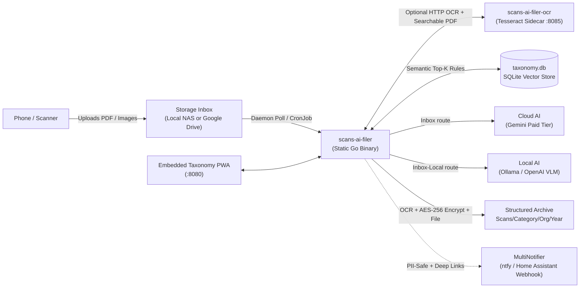

# Scans AI Filer (`scans-ai-filer`)

A privacy-first, single-binary Go document archivist that OCRs, classifies, renames, encrypts, and files scanned documents from an inbox into your own clean folder hierarchy (`Category/Org/Year`) — with **no database lock-in**.

Built for people who want AI auto-filing and searchable PDFs while keeping plain files in **Google Drive** or **local / NAS (SMB, NFS, Syncthing) folders**, with an embedded **Taxonomy Browser & Editor PWA** for rule management.

Compiles to a static `CGO_ENABLED=0` binary on `gcr.io/distroless/static-debian12:nonroot` (~10 MB, multi-arch `linux/amd64` and `linux/arm64`).

---

## Key Features

- **Dual Privacy Routing (`INBOX_ROUTES`):** Route everyday scans (`Inbox:gemini`) to paid-tier cloud Gemini while routing sensitive financial/medical scans (`Inbox-Local:ollama`) to a 100% local Ollama / OpenAI-compatible VLM on your LAN.
- **Deterministic OCR-First & Searchable PDFs:** Optional `scans-ai-filer-ocr` Tesseract sidecar extracts text deterministically (with a low-res visual glance for layout/logos) and embeds a full-document invisible searchable OCR text layer into every scanned PDF (`OCR_EMBED_PDF=true`).
- **AES-256 PDF Password Encryption (`PDF_PASSWORD`):** Encrypts PDFs (and wraps image scans into encrypted PDFs) *after* OCR text embedding and permanently purges plaintext originals / Google Drive plaintext revisions.
- **SQLite Vector Taxonomy & Self-Learning:** Learns new filing rules into a pure-Go SQLite vector store (`taxonomy.db`, powered by local Ollama `nomic-embed-text` or Gemini embeddings) and retrieves top-K semantic examples for every classification.
- **Embedded Taxonomy Browser/Editor PWA (`:8080`):** Browse/edit rules, review low-confidence learned rules, trigger an immediate **Scan Now**, run the **AI Taxonomy Gardener** (consolidate/merge duplicate rules), and run the **Storage Reorganizer** from your browser or phone.
- **Pluggable Storage, AI & Notifications:**
  - **Storage:** `gdrive` (pure Go stdlib RS256 OAuth2 + cached folder IDs) and `local` (host folder / SMB / NFS NAS / Syncthing), plus reference stubs for `s3` and `webdav`.
  - **AI:** `gemini` and `ollama`/`openai`, plus a reference stub for `anthropic`.
  - **Notifications (`MultiNotifier`):** Native `ntfy` (with per-priority success/error routing and **Open File / Open Folder** Google Drive action buttons) and Home Assistant / generic JSON `webhook`, plus an `smtp` reference stub.

---

## Privacy & Cloud AI Warning

> [!WARNING]
> **Read this before processing sensitive personal documents (bank statements, tax returns, medical records, IDs):**
> - **Cloud AI Free Tiers May Train on or Review Your Data:** If you use Google Gemini's **Free tier**, submitted documents may be used for model improvement and human review. Always bind your API key to a **Paid / Pay-as-you-go tier** (or Vertex AI with Zero Data Retention) — or route sensitive documents to a **local Ollama VLM** via `INBOX_ROUTES=Inbox:gemini,Inbox-Local:ollama`.
> - **Plaintext Cloud Metadata:** Filenames, folder paths, and Drive properties are stored unencrypted even when PDF contents are AES-256 encrypted. `scans-ai-filer` explicitly instructs all models to strip sensitive PII (account numbers, sort codes, IBANs, balances, policy/tax/ID numbers, addresses, DOBs, medical specifics) from filenames, descriptions, and notifications.

---

## Architecture



### Pluggable Interfaces & Extension Stubs
- **Storage (`internal/storage`):** `gdrive` (`internal/storage/gdrive`) and `local` (`internal/storage/local`), plus compile-checked reference stubs at `internal/storage/s3/s3.go` and `internal/storage/webdav/webdav.go`.
- **AI (`internal/ai`):** `gemini` (`internal/ai/gemini.go`) and `ollama`/`openai` (`internal/ai/ollama.go`), plus a compile-checked reference stub at `internal/ai/anthropic.go`.
- **Notifications (`internal/notify`):** `ntfy` (`internal/notify/ntfy.go`) and `webhook` (`internal/notify/webhook.go`) via `MultiNotifier` + `EventFilter`, plus a compile-checked reference stub at `internal/notify/smtp.go`.

See [CONTRIBUTING.md](CONTRIBUTING.md) for step-by-step instructions on adding new providers.

---

## Embedded Taxonomy Browser/Editor PWA

When running in daemon mode (`POLL_INTERVAL_SECONDS > 0`) with `WEB_UI_ENABLED=true`, `scans-ai-filer` serves a mobile-friendly PWA on `WEB_UI_ADDR` (default `:8080`):

- **Taxonomy Browser & Editor:** Search, filter, create, edit, confirm, or delete filing rules stored in `taxonomy.db`.
- **Filing History & Confidence Review:** Inspect recent PII-free filing decisions and confirm or adjust newly learned rules.
- **One-Tap Operations:**
  - **Scan Now** (`POST /api/actions/scan-now`) — immediately wakes the daemon poll loop without waiting for the next interval.
  - **AI Taxonomy Gardener** — analyzes your taxonomy rules to propose and apply merges/consolidations.
  - **Storage Reorganizer** — moves already-filed documents to match updated canonical rules and prunes empty folders (with dry-run preview and optional PII filename audit).

---

## Deterministic OCR & Searchable PDFs

When `OCR_ENDPOINT_URL` points to the `scans-ai-filer-ocr` sidecar (or `OCR_PROVIDER=auto` detects it):

1. **Embedded text first:** If a PDF already has a usable text layer (`>= OCR_MIN_CHARS`), it is extracted directly without invoking Tesseract.
2. **Tesseract OCR + Visual Glance:** For image scans or image-only PDFs, the sidecar runs deterministic Tesseract OCR (`OCR_LANG`) and optionally passes a compact low-resolution visual glance (`OCR_VISUAL_GLANCE_DIM=640`) alongside the OCR text so the AI model can read logos/letterheads while relying on exact OCR text for dates and names.
3. **Searchable PDF Embedding (`OCR_EMBED_PDF=true`):** Embeds an invisible searchable OCR text layer across all pages *before* AES-256 encryption, so your archived PDFs remain copy-pasteable and full-text searchable once unlocked.

---

## Quick Start

### 1. Docker Compose (Local Folder / NAS + OCR Sidecar + Taxonomy PWA)

```bash
cd deploy
cp .env.example .env
# Edit .env with your GEMINI_API_KEY (or Ollama settings)
mkdir -p scans/Inbox
docker compose up -d
```

- Drop any PDF or photo scan into `deploy/scans/Inbox/` — it will be OCR'd, classified, and filed into `deploy/scans/<Category>/<Org>/<Year>/`.
- Open the **Taxonomy PWA** at `http://localhost:8080`.
- For an SMB/NFS NAS mount, simply point `LOCAL_SCANS_DIR=/mnt/nas/scans` in `.env`.

### 2. Kubernetes (Helm OCI Chart — Daemon Mode)

```bash
helm upgrade --install scans-filer oci://ghcr.io/scubadam/charts/scans-ai-filer \
  --namespace scans-filer --create-namespace \
  --set workloadMode=deployment \
  --set config.pollIntervalSeconds=60 \
  --set persistence.enabled=true \
  --set ocrSidecar.enabled=true \
  --set webUI.enabled=true \
  --set secrets.existingSecret=scans-filer-secret \
  --set config.ntfyUrl="http://ntfy.ntfy.svc.cluster.local" \
  --set config.ntfyTopic="scans-filer"
```

### 3. Google Drive Setup (`STORAGE_PROVIDER=gdrive`)

1. Create a Google Cloud Service Account with the **Google Drive API** enabled and download its JSON key (`gdrive-sa.json`).
2. Create a `Scans` folder in your Google Drive with an `Inbox` subfolder inside it (plus `Inbox-Local` if using dual privacy routing).
3. Share the `Scans` folder with the Service Account's `client_email` as **Editor**.
4. Set `STORAGE_PROVIDER=gdrive` and mount `gdrive-sa.json` at `GOOGLE_APPLICATION_CREDENTIALS` (or pass inline via `GDRIVE_SA_JSON`).

---

## Maintenance CLI Flags

Run maintenance utilities against an existing archive (either locally or via `kubectl exec`):

| Flag | Description |
| :--- | :--- |
| `--dry-run` | Analyze documents or preview maintenance actions without modifying storage, DB, or sending notifications |
| `--bootstrap-taxonomy` | Walk already-filed documents in storage, diff against `taxonomy.csv`, and populate `TAXONOMY_DB_PATH` |
| `--tidy-taxonomy` | Run the AI Taxonomy Gardener to propose (with `--dry-run`) or apply rule consolidations & merges |
| `--reorg-storage` | Reorganize already-filed documents to match canonical `TAXONOMY_DB_PATH` rules and prune empty folders |
| `--sanitize-filenames` | Combined with `--reorg-storage`, runs an AI audit to scrub PII from existing filenames |
| `--backfill-pdfs` | Idempotently embed searchable OCR (`OCR_EMBED_PDF`) and/or AES-256 encryption (`PDF_PASSWORD`) into existing filed PDFs |
| `--limit N` | Limit the maximum number of files processed by `--reorg-storage` or `--backfill-pdfs` (`0` = unlimited) |

---

## Configuration Reference

### Storage
| Environment Variable | Default | Description |
| :--- | :--- | :--- |
| `STORAGE_PROVIDER` | `gdrive` | Storage backend (`gdrive`, `local`) |
| `LOCAL_ROOT_PATH` | `/data/scans` | Root scans directory when `STORAGE_PROVIDER=local` (must contain your `INBOX_FOLDER_NAME` subfolder) |
| `GOOGLE_APPLICATION_CREDENTIALS` | `/etc/gdrive/gdrive-sa.json` | Path to Google Service Account JSON key (`gdrive`) |
| `GDRIVE_SA_JSON` | *(optional)* | Inline Google Service Account JSON (alternative to file path) |
| `SCANS_FOLDER_NAME` | `Scans` | Root folder name in Google Drive / log paths |
| `INBOX_FOLDER_NAME` | `Inbox` | Default inbox subfolder name |

### AI & Dual Privacy Routing
| Environment Variable | Default | Description |
| :--- | :--- | :--- |
| `AI_PROVIDER` | `gemini` | Default AI backend (`gemini`, `ollama`, `openai`) when `INBOX_ROUTES` is unset |
| `INBOX_ROUTES` | *(unset)* | Comma-separated `Folder:provider` routes, e.g. `Inbox:gemini,Inbox-Local:ollama` |
| `GEMINI_API_KEY` | *(required for `gemini`)* | Paid-tier Gemini API key |
| `GEMINI_MODEL` | `gemini-2.5-flash` | Gemini model name |
| `OLLAMA_BASE_URL` | `http://ollama-service.default.svc.cluster.local:11434/v1` | Ollama or OpenAI-compatible endpoint (`OPENAI_BASE_URL` also supported) |
| `OLLAMA_MODEL` | `qwen2.5vl:3b` | Local VLM model name (`OPENAI_MODEL` also supported) |
| `OLLAMA_TEXT_MODEL` | *(defaults to `OLLAMA_MODEL`)* | Optional faster text-only model when OCR text is already extracted |
| `OLLAMA_API_KEY` | *(optional)* | Bearer token for OpenAI-compatible proxies (`OPENAI_API_KEY` also supported) |
| `OLLAMA_TIMEOUT_SECONDS` | `300` | HTTP timeout for local inference |
| `OLLAMA_MAX_PAGES` | `5` | Max PDF pages sent to local VLM |
| `OLLAMA_MAX_IMAGE_DIM` | `1536` | Max image dimension (px) for local VLM |

### OCR & PDF Security
| Environment Variable | Default | Description |
| :--- | :--- | :--- |
| `OCR_PROVIDER` | `auto` | OCR engine (`auto`, `http`, `none`) |
| `OCR_ENDPOINT_URL` | *(optional)* | HTTP OCR sidecar endpoint (e.g. `http://ocr-sidecar:8085/ocr`) |
| `OCR_LANG` | `eng` | Tesseract language code |
| `OCR_MIN_CHARS` | `80` | Minimum extracted text length to treat OCR/text layer as usable |
| `OCR_VISUAL_GLANCE_DIM` | `640` | Optional low-res visual glance image dimension (`0` disables) |
| `OCR_HYBRID_REMOTE` | `false` | Also use deterministic OCR + visual glance for remote Gemini calls |
| `OCR_EMBED_PDF` | `false` | Embed full-document invisible searchable OCR text layer into PDFs before filing/encryption |
| `PDF_PASSWORD` | *(empty)* | Optional AES-256 PDF user password (purges plaintext originals/revisions) |
| `PDF_OWNER_PASSWORD` | *(defaults to `PDF_PASSWORD`)* | Optional AES-256 PDF owner password |

### Daemon, Vector Taxonomy, Web UI & Logging
| Environment Variable | Default | Description |
| :--- | :--- | :--- |
| `POLL_INTERVAL_SECONDS` | `0` | `0` = single-shot CronJob/CLI; `> 0` = continuous daemon poll interval (e.g. `60`) |
| `BATCH_SIZE` | `10` | Max documents processed per poll cycle |
| `PAUSE_SECONDS` | `1` | Delay between documents in a batch |
| `DRY_RUN` | `false` | Classify and log without mutating storage or notifying (also `--dry-run`) |
| `LOG_LEVEL` | `info` | Log level (`debug`, `info`, `warn`, `error`; idle daemon polls log at `debug`) |
| `TAXONOMY_CSV_PATH` | *(auto-detect)* | Path to seed taxonomy CSV (see [examples/taxonomy.csv](examples/taxonomy.csv)) |
| `TAXONOMY_DB_PATH` | *(empty)* | Path to persistent SQLite vector taxonomy DB (e.g. `/var/lib/scans-ai-filer/taxonomy.db`) |
| `EMBEDDING_PROVIDER` | `auto` | Vector embedding backend (`auto`, `ollama`, `gemini`, `none`) |
| `EMBEDDING_MODEL` | *(provider default)* | Embedding model name (e.g. `nomic-embed-text`) |
| `TAXONOMY_TOP_K` | `8` | Number of top semantic taxonomy rules injected per prompt |
| `WEB_UI_ENABLED` | `false` | Enable the embedded Taxonomy Browser/Editor PWA (daemon mode) |
| `WEB_UI_ADDR` | `:8080` | Listen address for the embedded Web UI |

### Notifications (`MultiNotifier`)
| Environment Variable | Default | Description |
| :--- | :--- | :--- |
| `NOTIFY_ON_SUCCESS` | `true` | Global default: notify when documents are successfully filed |
| `NOTIFY_ON_ERROR` | `true` | Global default: notify when any document in a batch fails |
| `NTFY_URL` | *(empty)* | Self-hosted or public `ntfy` base URL (e.g. `http://ntfy.ntfy.svc.cluster.local`) |
| `NTFY_TOPIC` | *(empty)* | `ntfy` topic for filing notifications |
| `NTFY_ERROR_TOPIC` | *(defaults to `NTFY_TOPIC`)* | Optional separate `ntfy` topic for error batches |
| `NTFY_TOKEN` | *(optional)* | Bearer access token (`tk_...`) for authenticated `ntfy` servers |
| `NTFY_USERNAME` / `NTFY_PASSWORD` | *(optional)* | Basic auth credentials for `ntfy` (used when `NTFY_TOKEN` is unset) |
| `NTFY_PRIORITY` | `default` | `ntfy` priority for successful filings (`min`, `low`, `default`, `high`, `urgent`) |
| `NTFY_ERROR_PRIORITY` | `high` | `ntfy` priority for error notifications |
| `NTFY_CLICK_URL` | *(defaults to Drive `FileURL`)* | Optional override URL when tapping an `ntfy` notification |
| `NTFY_ON_SUCCESS` / `NTFY_ON_ERROR` | *(inherits global)* | Per-channel overrides for `ntfy` |
| `WEBHOOK_URL` | *(empty)* | Optional JSON webhook URL (Home Assistant / generic; `HA_WEBHOOK_URL` also supported) |
| `WEBHOOK_ON_SUCCESS` / `WEBHOOK_ON_ERROR` | *(inherits global)* | Per-channel overrides for webhook |

---

## Development & Testing

Open in VS Code / DevContainers (`.devcontainer/devcontainer.json`) or run directly with Go:

```bash
go vet ./...
go test -v -race ./internal/...
go test -tags=integration -v -race ./tests/integration/...
helm lint charts/scans-ai-filer
docker build -t scans-ai-filer:dev .
```

Opt-in live integration tests (skipped automatically unless credentials are supplied):

```bash
TEST_GEMINI_API_KEY="your-paid-key" \
TEST_GDRIVE_SA_PATH="/path/to/gdrive-sa.json" \
go test -tags=integration -v ./tests/integration/...
```

## License

GNU Affero General Public License v3.0 — see [LICENSE](LICENSE).
