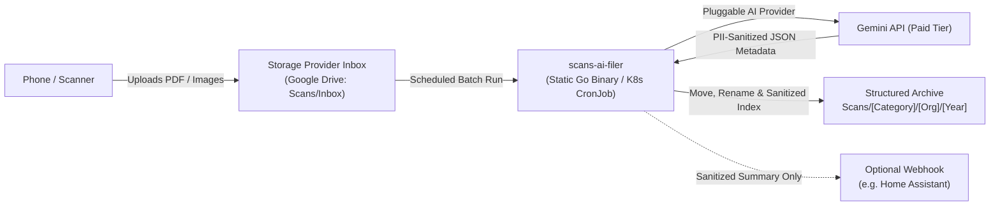

# Scans AI Filer (`scans-ai-filer`)

A privacy-first, zero-dependency Go document archivist that classifies, renames, tags, and files scanned documents from an inbox into a structured folder hierarchy using pluggable **Storage** and **AI** providers.

Compiles to a single static `CGO_ENABLED=0` binary on `gcr.io/distroless/static-debian12:nonroot` (~10 MB, multi-arch `linux/amd64` and `linux/arm64`).

---

## Privacy & Cloud AI Warning

> [!WARNING]
> **Read this before processing sensitive personal documents (bank statements, tax returns, medical records, IDs):**
> - **Cloud AI Free Tiers May Train on or Review Your Data:** If you use Google Gemini's **Free tier** (or free tiers of other cloud AI providers), submitted documents and prompts may be used for model improvement and human review under provider terms. Always verify your API key is bound to a **Paid / Pay-as-you-go billing tier** (e.g., Gemini API Tier 1+ or Vertex AI with Zero Data Retention) before sending personal scans.
> - **Plaintext Cloud Metadata:** Filenames, folder paths, and Google Drive search descriptions/properties are stored **unencrypted** by Google Drive even if you later password-protect the file contents. `scans-ai-filer` explicitly strips sensitive PII (account numbers, sort codes, IBANs, balances, policy/tax/ID numbers, addresses, DOBs, and medical specifics) from prompts, filenames, Drive descriptions, and webhook notifications — leaving only coarse, innocuous filing metadata (Date, Category, Issuer, Document Type, and a 2–5 word generic summary).
> - **Local AI Option:** A pluggable local AI provider (Ollama / OpenAI-compatible VLM) is tracked on the roadmap so sensitive scans can stay 100% inside your LAN.

---

## Architecture



### Pluggable Interfaces
- **Storage (`internal/storage`):** Abstracted behind `storage.Provider`. Ships with `gdrive` (pure Go stdlib RS256 Service Account OAuth2 + Drive v3 REST API). Future backends (Local NAS / SMB / S3 / WebDAV / Nextcloud) plug in cleanly.
- **AI (`internal/ai`):** Abstracted behind `ai.Provider`. Ships with `gemini` (`gemini-2.5-flash` default). Future local/cloud providers (Ollama, OpenAI-compatible, Anthropic) plug in cleanly.

---

## Configuration

| Environment Variable | Default | Description |
| :--- | :--- | :--- |
| `STORAGE_PROVIDER` | `gdrive` | Storage backend (`gdrive`) |
| `AI_PROVIDER` | `gemini` | AI classification backend (`gemini`) |
| `GEMINI_API_KEY` | *(required)* | Paid-tier Gemini API key |
| `GEMINI_MODEL` | `gemini-2.5-flash` | Gemini model name |
| `GOOGLE_APPLICATION_CREDENTIALS` | `/etc/gdrive/gdrive-sa.json` | Path to Google Service Account JSON key |
| `GDRIVE_SA_JSON` | *(optional)* | Inline Service Account JSON (alternative to file path) |
| `SCANS_FOLDER_NAME` | `Scans` | Root folder name in storage |
| `INBOX_FOLDER_NAME` | `Inbox` | Inbox subfolder inside `SCANS_FOLDER_NAME` |
| `TAXONOMY_CSV_PATH` | *(auto-detect)* | Path to filing taxonomy CSV (see `examples/taxonomy.csv`) |
| `BATCH_SIZE` | `10` | Max documents processed per run |
| `PAUSE_SECONDS` | `1` | Delay between documents in a batch |
| `DRY_RUN` | `false` | Classify and log without modifying storage or sending webhooks (also `--dry-run`) |
| `PDF_PASSWORD` | *(empty)* | Optional AES-256 PDF password. When set, PDFs are encrypted (and image scans wrapped into encrypted PDFs), uploaded as new files, and plaintext Inbox originals are permanently deleted so no unencrypted version history remains in Drive. |
| `PDF_OWNER_PASSWORD` | *(defaults to `PDF_PASSWORD`)* | Optional PDF owner password when `PDF_PASSWORD` is enabled |
| `WEBHOOK_URL` | *(empty)* | Optional JSON webhook URL (compatible with Home Assistant webhooks; `HA_WEBHOOK_URL` also supported) |

---

## Quick Start

### 1. Docker / Docker Compose
Copy `examples/taxonomy.csv` to `taxonomy.csv`, place your Google Service Account key at `gdrive-sa.json`, and run a one-shot batch (or schedule via host cron / systemd timer):

```bash
docker run --rm \
  --read-only \
  --cap-drop ALL \
  --security-opt no-new-privileges:true \
  -e GEMINI_API_KEY="your-paid-tier-key" \
  -e BATCH_SIZE="15" \
  -e TAXONOMY_CSV_PATH="/etc/scans-ai-filer/taxonomy.csv" \
  -v "$(pwd)/gdrive-sa.json:/etc/gdrive/gdrive-sa.json:ro" \
  -v "$(pwd)/taxonomy.csv:/etc/scans-ai-filer/taxonomy.csv:ro" \
  ghcr.io/scubadam/scans-ai-filer:0.1.0 --dry-run
```

Or use [deploy/docker-compose.yml](deploy/docker-compose.yml):
```bash
docker compose -f deploy/docker-compose.yml run --rm scans-ai-filer
```

### 2. Kubernetes (Helm OCI Chart)
```bash
helm upgrade --install scans-ai-filer oci://ghcr.io/scubadam/charts/scans-ai-filer \
  --namespace scans-filer --create-namespace \
  --set secrets.existingSecret=scans-filer-secret \
  --set taxonomy.existingConfigMap=scans-filer-taxonomy \
  --set config.webhookUrl="http://homeassistant.ha.svc.cluster.local:8123/api/webhook/scans-filer-notification"
```

Trigger a manual run anytime:
```bash
kubectl create job --from=cronjob/scans-ai-filer manual-run-1 -n scans-filer
kubectl logs -n scans-filer -l job-name=manual-run-1 -f
```

---

## Development & Integration Testing

Open the repository in VS Code / DevContainers (`.devcontainer/devcontainer.json`) or run directly with Go / Docker:

```bash
go vet ./...
go test -v -race ./internal/...
go test -tags=integration -v -race ./tests/integration/...
helm lint charts/scans-ai-filer
docker build -t scans-ai-filer:dev .
```

Opt-in live integration tests (skipped automatically unless credentials are supplied):
```bash
TEST_GEMINI_API_KEY="your-paid-key" \
TEST_GDRIVE_SA_PATH="/path/to/gdrive-sa.json" \
go test -tags=integration -v ./tests/integration/...
```

## License

GNU Affero General Public License v3.0 — see [LICENSE](LICENSE).
